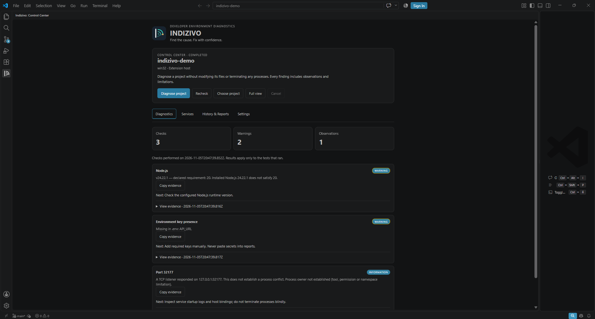
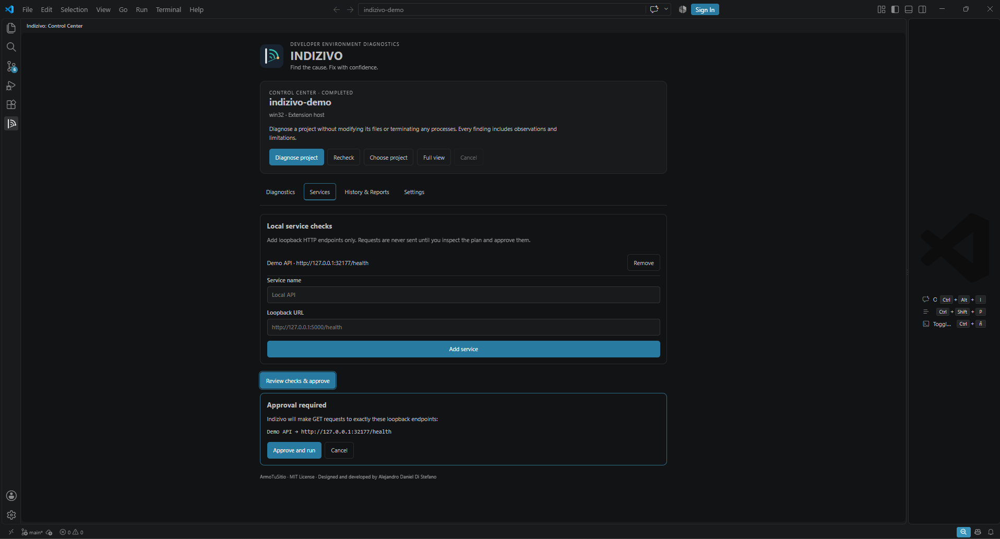

  

<h1 align="center">Indizivo</h1>

  <strong>Developer Environment Diagnostics for Visual Studio Code</strong>
   
  <em>Find the cause. Fix with confidence.</em>

  
  
  

---

## Understand your development environment

A project that refuses to start does not always have a code problem. An incompatible runtime, an unavailable local service, a missing environment variable or a port already in use may be enough to interrupt your work.

**Indizivo brings these signals together in one Visual Studio Code control center.** Run diagnostics, inspect the supporting evidence and decide what to investigate next — without switching between unrelated utilities.

Indizivo prioritizes **observed facts over guesses**. When it cannot establish a cause, it says so. It does not silently change your files or terminate processes.

## Screenshots

### Diagnostics — findings and supporting evidence

  

### Services — review and approve local checks

  

## Features

| Capability | What Indizivo does |
| --- | --- |
| **Project diagnostics** | Detects Node.js and Go projects and checks their locally available runtimes. |
| **Runtime compatibility** | Evaluates `engines.node`, `.nvmrc` and Go module requirements with npm-compatible range semantics (`~`, `^`, comparators, hyphen ranges, OR, wildcards). Anything it cannot interpret is reported as **inconclusive**, never as a false incompatibility. |
| **Go done right** | Separates the `go` minimum from the suggested `toolchain`, handles implicit `go 1.16` modules and malformed directives, and never lets the CLI download a toolchain during a probe. |
| **Port investigation** | Checks declared TCP ports over IPv4 (`127.0.0.1`) and IPv6 (`::1`) loopback, reporting which family answered, and, where the OS allows it, identifies the owning process read-only (IPv4 and IPv6 listeners, on Windows, Linux and macOS). Framework defaults (Next.js 3000, Vite 5173) are labeled **inferred**, not declared. |
| **Environment configuration** | Compares variable **names only** between `.env.example` and `.env`. A missing file is distinguished from an unreadable or blocked one, so an unreadable file is never reported as "absent". |
| **Optional toolchains** | Read-only version observations for Python, PHP, Java and Docker when their project markers exist, plus lockfile and `packageManager` consistency. No repository scripts are ever run. |
| **Monorepos and multi-root** | Shallow, bounded discovery of sub-projects with an explicit picker and a separate history per project. |
| **Local service health** | Tests user-configured loopback HTTP endpoints **only after you approve the exact plan**. Targets are validated against SSRF-style inputs, redirects are not followed and bodies are not read. |
| **Evidence-backed findings** | Every finding carries what was observed, how, when, with what confidence, what remains unknown and a copy-only next step. Findings have stable versioned IDs. |
| **Recheck and compare** | Compares sessions by stable check and endpoint identity (reordering endpoints cannot mix up results) without claiming that a change proves a fix. |
| **Reports and history** | Exports versioned JSON and readable Markdown (EN/ES) through VS Code's file system, redacted for credentials; copies evidence; keeps bounded, schema-validated local history. |
| **Remote awareness** | Sessions record where they ran (for example `linux · wsl`) and are never compared across different hosts. Real WSL, SSH and Dev Containers qualification is still pending. |
| **Resilience** | Global time budget per run, bounded output, cancellation that terminates only the processes Indizivo started (including their children, also when VS Code shuts down), and a safe fallback when VS Code storage is unavailable. |

### One interface, full control

The **Indizivo Control Center** lives in the VS Code Activity Bar and opens ready to diagnose. Its four sections cover the whole workflow:

- **Diagnostics:** choose a project, run or cancel checks, filter findings by status, inspect evidence and limitations, and copy evidence.
- **Services:** add or remove loopback HTTP targets, review the exact plan and approve probes.
- **History & Reports:** reopen and compare completed sessions, export Markdown or JSON, or delete local history.
- **Settings:** language (English / Spanish) and probe timeout, all from the UI.

No terminal is required for normal usage after installation. The interface supports keyboard navigation, ARIA tab semantics, reduced motion and forced-colors (high contrast) modes.

## Getting started

> **Version 0.2.1 (preview).** Automated gates pass on Windows, Linux and macOS and in an official VS Code Extension Host on Linux. Manual accessibility, remote-development (WSL, SSH, Dev Containers) and external usability qualification are still pending.

**Requirements:** desktop Visual Studio Code 1.99 or newer, a trusted local workspace and the relevant tools installed for each supported diagnostic. No account, AI key, container or hosted service is required.

1. Open your project folder in Visual Studio Code.
2. Open **Indizivo** from the Activity Bar.
3. Select **Diagnose project**.
4. Inspect the observations, their evidence and suggested next steps.
5. Optionally configure a localhost endpoint in **Services**, review the plan and approve the request.
6. Rerun diagnostics or export a report after investigating an issue.

Multi-root workspaces and monorepos let you choose the project to inspect. Untrusted and virtual workspaces run in a limited mode that disables active probes. WSL, SSH and Dev Containers have not yet been fully qualified.

### Install the preview VSIX

In VS Code, choose **Extensions → … → Install from VSIX…**, then select `indizivo-0.2.1.vsix` from [GitHub Releases](https://github.com/Drako01/indizivo/releases/tag/v0.2.1). Verify the package origin before installing.

Maintainers with authorized repository access can reproduce the release candidate with:

    npm ci
    npm run release:check

The release pipeline tests an isolated packaged VSIX installation on Linux. Cross-platform real-UI interaction, keyboard, zoom and screen-reader qualification remain release gates.

## Privacy and security

- **Local-first:** no account, mandatory AI provider, cloud backend or telemetry.
- **Read-only by default:** checks do not edit source code, install packages or terminate processes.
- **Explicit consent:** localhost HTTP requests require approval of their exact targets. A pending approval is discarded if the endpoints, project or workspace folders change.
- **Secrets stay private:** environment variable names can be checked, but .env values are not retained in findings.
- **Bounded operations:** supported reads and probes enforce limits, timeouts and cancellation; files are read through verified file handles and symlinks are not followed.
- **Redacted outputs:** exports and copied evidence mask common credential formats (tokens, bearer/basic headers, cookies, URL credentials, private keys).
- **Transparent outcomes:** a listening port does not prove a conflict, and a passing check is not a complete project-health guarantee.

Indizivo is not an operating-system sandbox. Runtime and process checks execute with the permissions of the VS Code extension host.

The detailed `PRIVACY.md` and `SECURITY.md` policies are included inside the installed VSIX; no access to the source repository is required.

## Current scope

The 0.2.1 preview focuses on **local Node.js and Go development environments**, with read-only observations for Python, PHP, Java and Docker. The interface is available in **English and Spanish**. Automatic remediation (suggestions are copy-only), remote network scanning, Docker/Compose orchestration and comprehensive WSL, SSH or container support are not part of these releases.

Indizivo is a diagnostic aid: a passing check is not a project-health guarantee, and "Enterprise AAAA" is an internal engineering goal, not a certification. Progress is tracked in the [active implementation pull request](https://github.com/Drako01/indizivo/pull/14), its upgrade checklist and the CTO audit. Future capabilities are described in the `ROADMAP.md` file bundled with the extension.

## Development

    npm ci
    npm run verify          # typecheck, type lint, security hygiene, unit/contract/adversarial tests
    npm run test:coverage-gate
    npm run test:e2e        # official Extension Host
    npm run package

The E2E suite launches an official VS Code Extension Host. It requires a graphical desktop environment. For reproducible issues, please include the extension version, operating system, relevant status and steps to reproduce.

## Feedback and support

Found an incorrect diagnosis, an incomplete check or a missing development environment? [Open a support request](https://armotusitio.com.ar/soporte/) and mention **Indizivo 0.2.1**.

**Never upload secrets, private environment values or confidential project logs.**

[Public support](https://armotusitio.com.ar/soporte/) · Changelog and security/privacy policies are bundled with the extension.

---

  <strong>Designed and developed by Alejandro Daniel Di Stefano</strong>
   
  © 2026 <a href="https://armotusitio.com.ar">ArmoTuSitio</a>. Copyright holder.
   
  Released under the MIT License (included with the extension).

